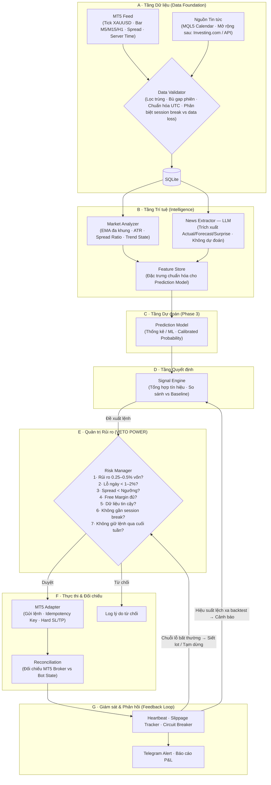
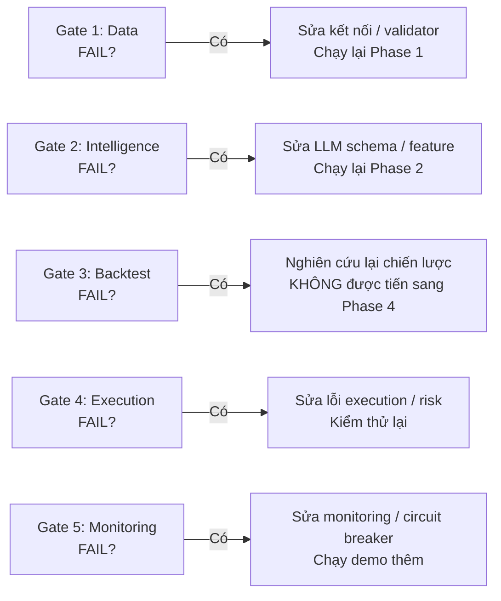

# 🚀 LỘ TRÌNH PHÁT TRIỂN HỆ THỐNG GIAO DỊCH MÔ-ĐUN (MODULAR QUANT TRADING SYSTEM)

> **Thị trường mục tiêu**: Vàng (`XAU/USD`)
> **Nền tảng giao dịch**: Exness — kết nối qua MetaTrader 5 Terminal
> **Ngôn ngữ cốt lõi**: Python 3.10+
> **Kiến trúc**: Modular Monolith · Event-Driven · Data Contracts (Pydantic) · Broker as SSOT
> **Phong cách giao dịch**: Intraday Swing (M15 – H1), kết hợp tin tức vĩ mô làm bộ lọc.
> Không scalping dưới M5 — chi phí spread Vàng quá lớn so với biên lợi nhuận mỗi lệnh ở khung thời gian nhỏ.

---

## 📑 MỤC LỤC

1. [Triết lý Thiết kế & Nguyên tắc An toàn](#1-triết-lý-thiết-kế--nguyên-tắc-an-toàn)
2. [Sơ đồ Kiến trúc & Luồng Dữ liệu](#2-sơ-đồ-kiến-trúc--luồng-dữ-liệu)
3. [Cấu trúc Thư mục Dự án](#3-cấu-trúc-thư-mục-dự-án)
4. [Lộ trình 5 Giai đoạn & Cổng Nghiệm thu](#4-lộ-trình-5-giai-đoạn--cổng-nghiệm-thu-quality-gates)
   - [Phase 1 — Data Foundation](#phase-1--data-foundation--nền-tảng-dữ-liệu--kết-nối-read-only)
   - [Phase 2 — Data Research & Intelligence](#phase-2--data-research--intelligence--thu-thập-đặc-trưng--llm-extractor)
   - [Phase 3 — Research, Backtest & Validation](#phase-3--research-backtest--validation--mô-hình-dự-đoán--kiểm-chứng-lợi-thế)
   - [Phase 4 — Risk, Execution & Demo](#phase-4--risk-execution--demo--rủi-ro-thấp--khả-năng-phục-hồi)
   - [Phase 5 — Monitoring & Controlled Deployment](#phase-5--monitoring--controlled-deployment--vận-hành--cắt-mạch-khẩn-cấp)
5. [Quy tắc Phòng thủ & Kiểm soát Khớp lệnh](#5-quy-tắc-phòng-thủ--kiểm-soát-khớp-lệnh-thực-tế)
6. [Phụ lục — Đặc thù Phiên Giao dịch Vàng & Exness](#6-phụ-lục--đặc-thù-phiên-giao-dịch-vàng--exness)

---

## 1. TRIẾT LÝ THIẾT KẾ & NGUYÊN TẮC AN TOÀN

### 1.1 Broker State là Nguồn Chân lý Duy nhất (SSOT)

- Trạng thái vị thế, số dư, tiền ký quỹ và lệnh chờ luôn được đối chiếu trực tiếp từ MT5 Server của Exness.
- Bot tuyệt đối không tự suy đoán trạng thái lệnh chỉ từ log nội bộ.
- Khi bot khởi động lại sau sự cố, module `reconciliation` quét toàn bộ lệnh theo Magic Number từ MT5 để khôi phục theo dõi, thay vì mở lệnh mới bừa bãi.

### 1.2 Tách biệt LLM Trích xuất và Mô hình Quyết định

- **News AI (LLM / Gemini API)**: Chỉ đóng vai trò đọc hiểu văn bản — trích xuất sự kiện, số liệu thực tế (Actual), dự báo (Forecast), mức độ bất ngờ (Surprise) và sắc thái tin tức.
- **Prediction Model**: Mô hình thống kê / học máy được huấn luyện và kiểm chứng trên dữ liệu quá khứ để ước lượng xác suất.
- **Quy tắc bất di bất dịch**: Confidence score do LLM tự đưa ra không bao giờ được coi là xác suất thắng. Xác suất phải đến từ mô hình định lượng có kiểm tra calibration (Brier Score / Reliability Diagram).

### 1.3 Bắt buộc Kiểm chứng Lợi thế & So sánh Baseline

- Mọi chiến lược phải vượt qua chiến lược cơ sở (Baseline) — ví dụ: EMA Crossover thuần túy hoặc Trend Following đơn giản không dùng AI — sau khi đã trừ toàn bộ chi phí (spread + slippage + commission).
- Kiểm thử Walk-Forward và Out-of-sample trên nhiều chu kỳ thị trường (trend mạnh, sideway, biến động cao vì tin tức), tránh overfitting hoặc may mắn ngẫu nhiên.
- Dữ liệu kiểm thử tối thiểu 2 năm, bao gồm nhiều trạng thái thị trường khác nhau. 6–12 tháng có thể quá ít cho chiến lược dựa trên tin vĩ mô.

### 1.4 Quản trị Rủi ro Khởi điểm Thận trọng

| Thông số | Giá trị kiểm thử ban đầu | Ghi chú |
|:---------|:--------------------------|:--------|
| Rủi ro mỗi lệnh | **0.25% – 0.5%** vốn | Tính dựa trên khoảng cách SL vật lý × Lot |
| Giới hạn lỗ ngày (Max Daily Loss) | **1% – 2%** vốn | Tính cả realized PnL + floating drawdown |
| Định nghĩa "ngày giao dịch" | Reset theo **nến Daily trên MT5** (GMT+2, hoặc GMT+3 khi DST) | Không dùng UTC 00:00 — phải khớp với server Exness |
| Circuit Breaker | Tự động ngắt giao dịch | Khi dữ liệu mất liên tục, mạng chập chờn, hoặc chuỗi lỗ bất thường |

Đây là các mức khởi điểm để kiểm thử, không phải mức tối ưu cho mọi tài khoản. Stop Loss cũng không đảm bảo giá khớp đúng mức dự kiến khi thị trường biến động mạnh (gap, slippage).

### 1.5 Chống Gửi Lệnh Trùng (Idempotency) & Phục hồi khi Crash

- Mỗi cơ hội giao dịch sinh ra một `Magic Number` + `Order Comment` duy nhất.
- Trước khi gửi lệnh mới, bot kiểm tra trên MT5 server xem đã có lệnh trùng Magic Number chưa.
- Khi bot restart, module `reconciliation` quét toàn bộ positions/orders từ MT5 trước khi tiếp tục vận hành.

---

## 2. SƠ ĐỒ KIẾN TRÚC & LUỒNG DỮ LIỆU



**Điểm khác biệt so với bản trước:**
- **Prediction Model** nằm ở tầng riêng (Phase 3), không gộp vào Intelligence Layer Phase 2.
- **Feedback Loop** từ Monitoring quay ngược lại Risk Manager và Signal Engine.
- **Data Validator** phân biệt rõ session break (gap phiên Vàng hàng ngày) với dữ liệu bị mất thực sự.
- **Nguồn tin tức** xác định cụ thể: MQL5 Calendar trước, mở rộng sau.

---

## 3. CẤU TRÚC THƯ MỤC DỰ ÁN

```text
trading-bot/
├── app/
│   ├── __init__.py
│   ├── main.py                       # Entry point — điều phối toàn hệ thống
│   ├── config.py                     # Đọc cấu hình từ .env + giá trị mặc định
│   │
│   ├── core/
│   │   ├── __init__.py
│   │   ├── schemas.py                # Pydantic v2 models: Tick, Bar, Signal, Order, NewsEvent
│   │   ├── constants.py              # Hằng số: Symbol, Timeframes, Error codes, Session times
│   │   └── enums.py                  # Enum: TradeDirection, SignalType, RiskDecision, SessionState
│   │
│   ├── data/
│   │   ├── __init__.py
│   │   ├── mt5_market_data.py        # Lấy tick, nến, spread, thông tin symbol từ MT5
│   │   ├── economic_calendar.py      # MQL5 Calendar — lịch kinh tế tích hợp sẵn MT5
│   │   ├── news_collector.py         # Thu thập tin tức bên ngoài (Phase 2, mở rộng)
│   │   ├── data_validator.py         # Kiểm tra: gap nến, trùng lặp, session break vs data loss
│   │   └── storage.py                # SQLite — lưu tick/bar/spread/signals/trades
│   │
│   ├── intelligence/
│   │   ├── __init__.py
│   │   ├── market_analyzer.py        # EMA đa khung, ATR, trend state, dynamic spread ratio
│   │   └── news_extractor.py         # LLM trích xuất sự kiện & số liệu (chỉ extract, không predict)
│   │
│   ├── strategy/
│   │   ├── __init__.py
│   │   ├── prediction_model.py       # Mô hình định lượng — huấn luyện & calibration (Phase 3)
│   │   ├── baseline_strategy.py      # Chiến lược benchmark không dùng AI
│   │   └── signal_engine.py          # Tổng hợp tín hiệu chính
│   │
│   ├── risk/
│   │   ├── __init__.py
│   │   └── risk_manager.py           # Veto engine · Lot sizing · Daily loss · Spread filter · Session guard
│   │
│   ├── execution/
│   │   ├── __init__.py
│   │   ├── mt5_adapter.py            # Kết nối MT5 terminal · Gửi lệnh (Idempotency) · SL/TP
│   │   └── reconciliation.py         # Đối chiếu vị thế thực từ broker (SSOT) · Crash recovery
│   │
│   └── monitoring/
│       ├── __init__.py
│       ├── logger.py                 # Log màu console + file xoay vòng (loguru)
│       ├── circuit_breaker.py        # Tự ngắt khi mất kết nối / chuỗi lỗ / dữ liệu hỏng
│       ├── telegram_bot.py           # Gửi thông báo tức thời về điện thoại
│       └── performance.py            # Đo slippage thực tế · P&L · Winrate · So sánh vs backtest
│
├── backtests/
│   ├── backtest_engine.py            # Mô phỏng lệnh với spread động + slippage + commission
│   ├── walk_forward.py               # Chia tập Train / Val / Test theo thời gian (no leakage)
│   └── datasets/                     # Dữ liệu nến & tin tức lịch sử đã chuẩn hóa
│
├── tests/
│   ├── test_data_validator.py        # Phát hiện gap phiên vs data loss
│   ├── test_risk_manager.py          # Giới hạn lỗ · Lot size · Spread filter · Session guard
│   ├── test_idempotency.py           # Chống gửi lệnh trùng
│   ├── test_reconciliation.py        # Phục hồi vị thế sau crash
│   └── test_schemas.py              # Validate Pydantic contracts
│
├── logs/
├── .env.example                      # Mẫu biến môi trường (commit vào git)
├── .env                              # Thông tin bí mật (KHÔNG commit)
├── .gitignore
├── requirements.txt
├── ROADMAP.md
└── README.md
```

**Thay đổi so với bản trước:**
- `prediction_model.py` chuyển từ `intelligence/` sang `strategy/` — vì nó là một phần của quy trình ra quyết định, không phải tầng trích xuất dữ liệu.
- Thêm `enums.py` để định nghĩa rõ các trạng thái (`SessionState`, `RiskDecision`...) thay vì dùng string rời rạc.
- `news_extractor.py` (đổi tên rõ hơn) — nhấn mạnh vai trò chỉ trích xuất, không dự đoán.

---

## 4. LỘ TRÌNH 5 GIAI ĐOẠN & CỔNG NGHIỆM THU (QUALITY GATES)

---

### PHASE 1 — Data Foundation — Nền tảng Dữ liệu & Kết nối Read-only

> **Mục tiêu duy nhất**: Xây nền móng dữ liệu vững chắc, kết nối MT5 ở chế độ chỉ đọc, chuẩn hóa timestamp, kiểm tra tính toàn vẹn dữ liệu và nhận diện đúng đặc thù phiên giao dịch Vàng. **Tuyệt đối không mở lệnh.**

**Công việc cụ thể:**

1. **Môi trường & Cấu hình**
   - Tạo môi trường ảo Python (venv).
   - Tạo `requirements.txt`: `MetaTrader5`, `pydantic>=2.0`, `pandas`, `loguru`, `python-dotenv`.
   - Tạo `.env.example` và `config.py` đọc cấu hình tài khoản MT5 Exness Demo (login, password, server) từ biến môi trường.

2. **Data Contracts (`core/schemas.py`, `core/enums.py`, `core/constants.py`)**
   - Định nghĩa kiểu dữ liệu chặt chẽ: `TickData`, `BarData`, `AccountInfo`, `SymbolCondition`.
   - Định nghĩa Enum: `Timeframe`, `SessionState` (OPEN, CLOSED, PRE_CLOSE), `DataQuality`.
   - Hằng số: mốc giờ phiên Vàng, symbol names trên Exness (`XAUUSD` hoặc `XAUUSDm`).

3. **MT5 Adapter — Chế độ Read-only (`execution/mt5_adapter.py`)**
   - Kết nối MT5 terminal Exness Demo.
   - Đọc thông tin tài khoản: Balance, Equity, Free Margin, Leverage thực tế, Margin Level.
   - Đọc thông số symbol XAUUSD: Digits, Point, Contract Size, Min/Max Lot, Lot Step, Margin Mode.
   - Đọc Spread thực tế (Ask - Bid) theo thời gian thực.
   - Phát hiện trạng thái kết nối server và ghi timestamp UTC.

4. **Data Validator (`data/data_validator.py`)**
   - Phát hiện nến bị thiếu (gap) trong chuỗi dữ liệu.
   - **Phân biệt session break vs data loss**: Gap xảy ra trong khung giờ đóng phiên Vàng hàng ngày (~20:58–23:01 GMT+0) là bình thường, không phải lỗi. Gap ngoài khung giờ này là dữ liệu bị mất.
   - Phát hiện nến trùng lặp (duplicate timestamp).
   - Kiểm tra chênh lệch thời gian giữa client và MT5 server.

5. **Storage (`data/storage.py`)**
   - SQLite với schema rõ ràng cho: ticks, bars (M5, M15, H1), spread history.
   - Hỗ trợ upsert (insert or update) để tránh trùng lặp khi thu thập lại.
   - Có thể tái tạo lại chuỗi giá từ database.

6. **Logger (`monitoring/logger.py`)**
   - Log màu ra console + file xoay vòng (rotation).
   - Mỗi dòng log có timestamp UTC, tên module, mức severity.

**🚪 CỔNG NGHIỆM THU PHASE 1 (Quality Gate 1):**

- [ ] Kết nối ổn định với MT5 Exness Demo ở chế độ Read-only.
- [ ] In ra đúng thông tin tài khoản (Balance, Leverage) và thông số XAUUSD (Digits, Spread, Contract Size).
- [ ] Dữ liệu nến M5/M15/H1 được lưu liên tục vào SQLite, timestamp chuẩn UTC, không có bản ghi trùng lặp.
- [ ] Data Validator phân biệt chính xác session break (gap phiên hàng ngày) với data loss thực sự.
- [ ] Có thể tái tạo lại chuỗi dữ liệu giá từ database mà không có khoảng trống bất thường ngoài session break.

---

### PHASE 2 — Data Research & Intelligence — Thu thập Đặc trưng & LLM Extractor

> **Mục tiêu**: Xây dựng tầng phân tích kỹ thuật và tầng đọc hiểu tin tức vĩ mô. Tạo ra bộ đặc trưng (features) chuẩn hóa cho Prediction Model ở Phase 3. **Chưa xây mô hình dự đoán ở Phase này.**

**Công việc cụ thể:**

1. **Market Analyzer (`intelligence/market_analyzer.py`)**
   - EMA đa khung thời gian: EMA 21/50/200 trên M15, H1, H4.
   - ATR (Average True Range) để đo biến động thực tế — dùng cho SL/TP linh hoạt.
   - **Dynamic Spread Ratio**: `current_spread / EMA_30min(spread)`. Nếu ratio > 2.0, đánh dấu thị trường đang bất thường.
   - Phân loại Trend State: `STRONG_UP`, `UP`, `RANGE`, `DOWN`, `STRONG_DOWN` dựa trên vị trí giá so với EMA đa khung.

2. **Economic Calendar (`data/economic_calendar.py`)**
   - **Nguồn ban đầu**: `mt5.calendar_range()` — hàm tích hợp sẵn trong MetaTrader5 Python package. Không cần scraping bên ngoài.
   - Lọc các sự kiện tác động mạnh tới USD/Vàng: CPI, NFP, FOMC Rate Decision, PPI, Retail Sales, GDP, Jobless Claims.
   - Gắn nhãn thời gian UTC chính xác của từng sự kiện.
   - Đánh dấu trạng thái: `UPCOMING` (sắp tới), `JUST_RELEASED` (vừa công bố), `PAST`.

3. **News Extractor — LLM (`intelligence/news_extractor.py`)**
   - Dùng Gemini API để trích xuất cấu trúc từ tin tức:
     - Số liệu: Actual, Forecast, Previous.
     - Surprise Score: `(Actual - Forecast) / |Forecast|` (tính bằng code, không nhờ LLM tính).
     - Tóm tắt định tính: LLM mô tả tác động tiềm năng lên USD và Vàng.
   - **LLM chỉ extract, không predict.** Output là structured JSON theo Pydantic schema.
   - Fallback: Nếu LLM API lỗi/timeout, hệ thống vẫn hoạt động bằng dữ liệu kỹ thuật thuần túy.

4. **Feature Store (chuẩn bị cho Phase 3)**
   - Lưu các đặc trưng đã tính vào SQLite với timestamp UTC: trend state, ATR, spread ratio, surprise score, thời gian kể từ tin cuối cùng.
   - Đảm bảo mỗi feature có: nguồn gốc, thời điểm tính, độ trễ tính toán.

**🚪 CỔNG NGHIỆM THU PHASE 2 (Quality Gate 2):**

- [ ] Market Analyzer tính đúng EMA, ATR, Spread Ratio trên dữ liệu thực từ Exness MT5.
- [ ] Economic Calendar lấy đúng lịch sự kiện USD từ MQL5 Calendar, có timestamp UTC.
- [ ] News Extractor (LLM) trả về đúng schema JSON; Surprise Score được tính bằng code, không phải LLM.
- [ ] Hệ thống vẫn chạy bình thường khi LLM API lỗi (graceful degradation).
- [ ] Mọi feature được lưu với nguồn gốc + timestamp + độ trễ đo được (latency tracking).

---

### PHASE 3 — Research, Backtest & Validation — Mô hình Dự đoán & Kiểm chứng Lợi thế

> **Mục tiêu**: Xây dựng chiến lược, huấn luyện mô hình dự đoán, so sánh với Baseline, và kiểm thử nghiêm ngặt ngoài mẫu. **Đây là phase quyết định bot có đáng giao dịch hay không.**

**Công việc cụ thể:**

1. **Baseline Strategy (`strategy/baseline_strategy.py`)**
   - Chiến lược đơn giản không dùng AI — ví dụ: EMA Crossover (EMA 21 cắt EMA 50 trên H1).
   - Mục đích: làm thước đo. Nếu chiến lược chính không thắng được Baseline sau chi phí, thì AI không thêm giá trị.

2. **Prediction Model (`strategy/prediction_model.py`)**
   - Huấn luyện mô hình thống kê/ML trên bộ features đã thu thập ở Phase 2.
   - **Calibration Check bắt buộc**: Xác suất mô hình đưa ra phải khớp với tần suất thắng thực tế (kiểm tra qua Brier Score / Reliability Diagram).
   - Nếu mô hình chưa calibrated, dùng Platt Scaling hoặc Isotonic Regression để hiệu chỉnh.

3. **Signal Engine (`strategy/signal_engine.py`)**
   - Hợp nhất tín hiệu kỹ thuật + xác suất từ Prediction Model thành: `BUY`, `SELL`, hoặc `STAND_ASIDE`.
   - Tính Expected Value (EV) cho mỗi cơ hội: `EV = P(win) × avg_win - P(loss) × avg_loss - cost`.
   - Chỉ phát tín hiệu khi `EV > 0` sau chi phí.

4. **Backtest Engine (`backtests/backtest_engine.py`)**
   - Mô phỏng đúng chi phí thực tế: Spread động (thay đổi theo giờ trong ngày), Slippage dự kiến, Commission.
   - **No look-ahead bias**: Dữ liệu tại thời điểm ra quyết định không chứa thông tin tương lai.
   - Ghi nhận: Winrate, Profit Factor, Max Drawdown, Sharpe Ratio, số lệnh trung bình/tuần.

5. **Walk-Forward Validation (`backtests/walk_forward.py`)**
   - Chia dữ liệu theo thời gian: Train → Validation → Out-of-sample Test. Không xáo trộn ngẫu nhiên.
   - Kiểm thử trên **ít nhất 2 năm dữ liệu**, bao gồm:
     - Giai đoạn Vàng tăng mạnh (bull run).
     - Giai đoạn sideway thanh khoản thấp.
     - Giai đoạn biến động cao vì tin tức (CPI shock, Fed pivot, chiến tranh).
   - Đánh giá: Hiệu suất có sụp đổ ngoài tập train không? Lợi nhuận có phụ thuộc vào một vài lệnh may mắn?

**🚪 CỔNG NGHIỆM THU PHASE 3 (Quality Gate 3) — QUAN TRỌNG NHẤT:**

- [ ] Chiến lược chính vượt trội hơn Baseline **sau khi đã trừ hết chi phí** (spread + slippage + commission).
- [ ] Hiệu suất duy trì ổn định tương đối trên tập Out-of-sample (không sụp đổ sau tập train).
- [ ] Lợi nhuận không bị phụ thuộc vào một vài giao dịch may mắn bất thường.
- [ ] Max Drawdown ngoài mẫu ở mức chấp nhận được (đây là ngưỡng đánh giá, không phải bằng chứng duy nhất cho chiến lược tốt).
- [ ] Prediction Model đã qua calibration check: xác suất dự đoán khớp tần suất thắng thực tế.
- [ ] **Nếu không vượt qua Gate 3, DỪNG LẠI. Không tiến sang Phase 4.** Quay về nghiên cứu lại chiến lược.

---

### PHASE 4 — Risk, Execution & Demo — Rủi ro thấp & Khả năng Phục hồi

> **Mục tiêu**: Kích hoạt đặt lệnh tự động trên Exness MT5 Demo với mức rủi ro kiểm thử thận trọng. Kiểm thử toàn bộ tình huống lỗi thực tế.

**Công việc cụ thể:**

1. **Risk Manager (`risk/risk_manager.py`) — Bộ lọc bắt buộc trước mỗi lệnh**
   - **Lot Sizing**: Tính kích thước Lot theo rủi ro 0.25–0.5% vốn dựa trên khoảng cách SL vật lý (ATR-based SL).
   - **Daily Loss Limit**: Tự động khóa mở lệnh mới khi lỗ ngày chạm 1–2%. Reset theo nến Daily MT5 (GMT+2/+3).
   - **Bộ lọc Spread kép**:
     - Ngưỡng tuyệt đối: Cấm vào nếu spread > `MAX_ABSOLUTE_SPREAD` pips.
     - Ngưỡng tương đối: Cấm vào nếu `current_spread / EMA_30min(spread) > 2.0`.
   - **Kiểm tra Ký quỹ & Đòn bẩy Thực tế**: Đọc trực tiếp `account_info.margin_free`, `account_info.leverage`, `symbol_info.margin_initial` từ MT5. Không hardcode.
   - **Session Guard**: Cấm mở lệnh mới trong 15 phút trước khi phiên Vàng đóng. Cấm giữ lệnh qua cuối tuần (hoặc buộc giảm lot đáng kể).
   - **News Shield**: Cấm mở lệnh mới 30 phút trước và 5 phút sau tin tức đỏ USD.

2. **MT5 Adapter — Chế độ Execution (`execution/mt5_adapter.py`)**
   - Gửi lệnh đi kèm `Magic Number` duy nhất.
   - Luôn đính kèm Hard Stop Loss khi gửi lệnh lên server — bảo vệ tài khoản ngay cả khi bot tắt.
   - Xử lý mã lỗi MT5: `TRADE_RETCODE_REQUOTE`, `TRADE_RETCODE_OFF_QUOTES`, `TRADE_RETCODE_TIMEOUT`, `TRADE_RETCODE_INVALID_STOPS`.
   - Cơ chế retry có giới hạn (tối đa 2 lần, với delay giữa các lần).

3. **Reconciliation Engine (`execution/reconciliation.py`)**
   - Quét vị thế định kỳ (mỗi 30 giây) từ MT5 server để đồng bộ với bộ nhớ nội bộ.
   - **Crash Recovery Test**: Tắt bot đột ngột khi đang có lệnh mở → Bật lại → Xác nhận bot nhận diện đúng vị thế và tiếp tục quản lý (SL/TP/Trailing) thay vì mở lệnh trùng.
   - Phát hiện lệnh bị đóng bởi broker (Stop Out) mà bot chưa biết.

4. **Kiểm thử Lỗi Thực tế (Fault Injection Testing)**
   - Giả lập mất mạng khi đang gửi lệnh.
   - Giả lập timeout sau khi server nhận lệnh nhưng chưa trả kết quả.
   - Giả lập spread giãn đột biến để xác nhận Risk Manager chặn lệnh.
   - Giả lập bot restart khi đang có 2–3 vị thế mở.

**🚪 CỔNG NGHIỆM THU PHASE 4 (Quality Gate 4):**

- [ ] Vượt qua 100% bài kiểm thử lỗi: mất mạng, timeout, server từ chối, restart khi có vị thế.
- [ ] Idempotency hoạt động: không bao giờ gửi lệnh trùng dù gặp timeout.
- [ ] Risk Manager chặn đứng thành công mọi tình huống vi phạm rủi ro giả lập.
- [ ] Reconciliation nhận diện đúng 100% vị thế sau mỗi lần restart.
- [ ] Hoạt động ổn định trên tài khoản Exness MT5 Demo trong **ít nhất 2 tuần** điều kiện thị trường thực.

---

### PHASE 5 — Monitoring & Controlled Deployment — Vận hành & Cắt mạch Khẩn cấp

> **Mục tiêu**: Vận hành bền bỉ, có cơ chế cắt mạch khẩn cấp, báo cáo tức thời và quy trình đánh giá trước khi cân nhắc tài khoản Real.

**Công việc cụ thể:**

1. **Circuit Breaker (`monitoring/circuit_breaker.py`)**
   - **Safe Mode**: Tự động chuyển bot sang chế độ Read-only (ngừng mở lệnh mới, chỉ quản lý lệnh đang mở) khi:
     - Mất kết nối MT5 quá 60 giây liên tục.
     - Chuỗi thua lỗ liên tiếp vượt ngưỡng cấu hình (ví dụ: 5 lệnh thua liên tiếp).
     - Drawdown trong ngày chạm giới hạn.
   - **Emergency Kill Switch**: Đóng toàn bộ vị thế và hủy toàn bộ lệnh chờ chỉ bằng một tín hiệu (lệnh Telegram hoặc file flag).

2. **Telegram Alert Bot (`monitoring/telegram_bot.py`)**
   - Thông báo thời gian thực: Mở lệnh, Khớp SL/TP, Cảnh báo spread giãn, Từ chối lệnh vì rủi ro.
   - Báo cáo cuối ngày: P&L, Winrate, Drawdown, số lệnh, so sánh với backtest.
   - Hỗ trợ lệnh điều khiển: `/status`, `/kill`, `/pause`, `/resume`.

3. **Performance Tracker (`monitoring/performance.py`)**
   - Thống kê slippage thực tế: chênh lệch giữa giá yêu cầu và giá khớp trên MT5.
   - So sánh chi phí giao dịch thực tế (spread + slippage) với giả định trong backtest.
   - Theo dõi: Sharpe Ratio thực tế, Expectancy, Profit Factor theo tuần/tháng.
   - **Drift Detection**: Nếu hiệu suất thực tế lệch xa so với backtest quá một ngưỡng, tự động cảnh báo và đề xuất tạm dừng.

4. **Quy trình Đánh giá Trước khi Chuyển sang Real**
   - Chạy Demo trong thời gian đủ dài (tối thiểu 4–8 tuần, bao gồm cả các tuần tin tức quan trọng).
   - So sánh: Winrate demo vs backtest, Drawdown demo vs backtest, Slippage thực vs giả định.
   - Nếu kết quả demo lệch xa backtest → Quay lại Phase 3 để điều tra nguyên nhân.
   - Chuyển sang Real với **lot nhỏ nhất có thể** (0.01 lot) trước khi tăng dần.

**🚪 CỔNG NGHIỆM THU PHASE 5 (Quality Gate 5):**

- [ ] Hệ thống chạy liên tục 24/5 trên máy/VPS, tự phục hồi sau sự cố mạng mà không cần can thiệp thủ công.
- [ ] Circuit Breaker kích hoạt chính xác khi mô phỏng các tình huống nguy hiểm.
- [ ] Emergency Kill Switch đóng toàn bộ lệnh trong vòng 5 giây khi được kích hoạt.
- [ ] Báo cáo slippage và chi phí giao dịch thực tế khớp hợp lý với giả định backtest.
- [ ] Có đủ dữ liệu demo để đưa ra quyết định có căn cứ về việc chuyển sang Real hay cần điều chỉnh chiến lược.

---

## 5. QUY TẮC PHÒNG THỦ & KIỂM SOÁT KHỚP LỆNH THỰC TẾ

| Yếu tố | Rủi ro Thực tế | Cơ chế Kiểm soát |
|:--------|:----------------|:------------------|
| **Ký quỹ & Đòn bẩy** | Đòn bẩy thay đổi tùy loại tài khoản (Standard/Pro/Raw), pháp nhân Exness, thời điểm tin tức. | Đọc `account_info.leverage`, `symbol_info.margin_initial`, `account_info.margin_free` trực tiếp từ MT5 trước mỗi lệnh. Không hardcode bất kỳ giá trị nào. |
| **Spread Vàng biến động** | Spread giãn mạnh lúc giao phiên, trước/sau tin đỏ, và khi thanh khoản thấp. | Bộ lọc kép: ngưỡng tuyệt đối (`max_spread_pips`) + ngưỡng tương đối (`spread / EMA_30min_spread > 2.0`). Cả hai ngưỡng cần được kiểm chứng bằng dữ liệu spread lịch sử thu thập ở Phase 1. |
| **Trượt giá (Slippage)** | Giá khớp lệch xa giá yêu cầu, đặc biệt khi thị trường biến động mạnh. SL có thể bị trượt. | Dự phòng slippage trong công thức tính Lot. Ghi nhận slippage thực tế mỗi lệnh để so sánh với backtest. Không dùng Market Order khi spread đang giãn. |
| **Gửi Lệnh Trùng** | Timeout → Bot gửi lại → Nhân đôi khối lượng vị thế. | `Magic Number` duy nhất cho mỗi cơ hội. Trước khi gửi lệnh mới, kiểm tra trên server broker xem đã có lệnh trùng Magic chưa. |
| **Crash & Khôi phục** | Bot crash khi đang có lệnh mở → Mất theo dõi vị thế. | `reconciliation.py` quét toàn bộ positions theo Magic Number khi khởi động. Lệnh luôn có Hard SL trên server broker nên vốn được bảo vệ ngay cả khi bot tắt. |
| **Gap cuối tuần** | Giá mở cửa thứ Hai nhảy xa so với giá đóng cửa thứ Sáu → SL bị trượt qua. | Risk Manager cấm giữ lệnh qua cuối tuần (hoặc buộc giảm lot). Cảnh báo Telegram trước 1 giờ khi thị trường sắp đóng cuối tuần. |
| **Session Break hàng ngày** | Vàng đóng phiên ~20:58–23:01 GMT+0 mỗi ngày. Spread giãn rất to ngay trước/sau giờ này. | Session Guard cấm mở lệnh mới 15 phút trước session break. Data Validator nhận diện gap phiên là bình thường, không báo lỗi dữ liệu. |

---

## 6. PHỤ LỤC — ĐẶC THÙ PHIÊN GIAO DỊCH VÀNG & EXNESS

### 6.1 Giờ Phiên Giao dịch Vàng (XAU/USD) trên Exness MT5

| Phiên | Giờ GMT+0 | Giờ Việt Nam (GMT+7) | Đặc điểm |
|:------|:----------|:---------------------|:---------|
| Sydney Open | 22:00 | 05:00 | Thanh khoản thấp, spread rộng |
| Tokyo | 00:00 – 09:00 | 07:00 – 16:00 | Thanh khoản trung bình |
| London | 08:00 – 17:00 | 15:00 – 00:00 | Thanh khoản cao, biến động mạnh |
| New York | 13:00 – 22:00 | 20:00 – 05:00 | Thanh khoản cao nhất, tin tức USD tập trung |
| **Session Break (Vàng đóng)** | **~20:58 – 23:01** | **~03:58 – 06:01** | **Không giao dịch. Spread giãn cực to.** |

> Lưu ý: Giờ chính xác có thể lệch ±vài phút và thay đổi khi chuyển DST (giờ mùa hè châu Âu/Mỹ). Bot phải đọc `symbol_info.trade_mode` và `symbol_info.session_deals` từ MT5 để xác định giờ phiên chính xác.

### 6.2 Nguồn Tin Tức — Lộ trình Mở rộng

| Giai đoạn | Nguồn | Cách truy cập |
|:----------|:------|:--------------|
| Phase 2 (ban đầu) | **MQL5 Calendar** | `mt5.calendar_range()` — tích hợp sẵn, không cần API key |
| Phase 2+ (mở rộng) | Investing.com / TradingEconomics | API có trả phí hoặc scraping (cần xem xét ToS) |
| Phase 3+ (nâng cao) | Reuters / Bloomberg Terminal API | Chi phí cao, chỉ cần khi hệ thống đã chứng minh lợi thế |

### 6.3 Quy trình Gate Fail — Khi Không Vượt Cổng Nghiệm thu



> **Quy tắc cứng**: Nếu Gate 3 (Backtest & Validation) không đạt, **DỪNG HOÀN TOÀN**. Không tiến sang giao dịch Demo. Quay lại nghiên cứu chiến lược hoặc thu thập thêm dữ liệu.

---

## 🧭 BƯỚC HÀNH ĐỘNG NGAY: TRIỂN KHAI PHASE 1

Theo đúng lộ trình, chúng ta tập trung 100% vào **Phase 1 — Data Foundation**:

1. Tạo môi trường ảo Python, `requirements.txt`, `.env.example`.
2. Định nghĩa Data Contracts trong `app/core/schemas.py`, `app/core/enums.py`, `app/core/constants.py`.
3. Viết `app/config.py` đọc cấu hình từ biến môi trường.
4. Viết `app/execution/mt5_adapter.py` ở chế độ **Read-only**:
   - Kết nối MT5 terminal Exness Demo.
   - Đọc thông tin tài khoản + thông số XAUUSD + spread thực tế.
5. Viết `app/data/data_validator.py`: Kiểm tra gap nến, phân biệt session break vs data loss.
6. Viết `app/data/storage.py`: Lưu tick/bar vào SQLite.
7. Viết `app/monitoring/logger.py`: Log chuẩn với loguru.

**Mục tiêu Phase 1 là tạo nền tảng dữ liệu đáng tin cậy — vì nếu dữ liệu đầu vào sai, mọi thứ phía sau đều sai theo.**
